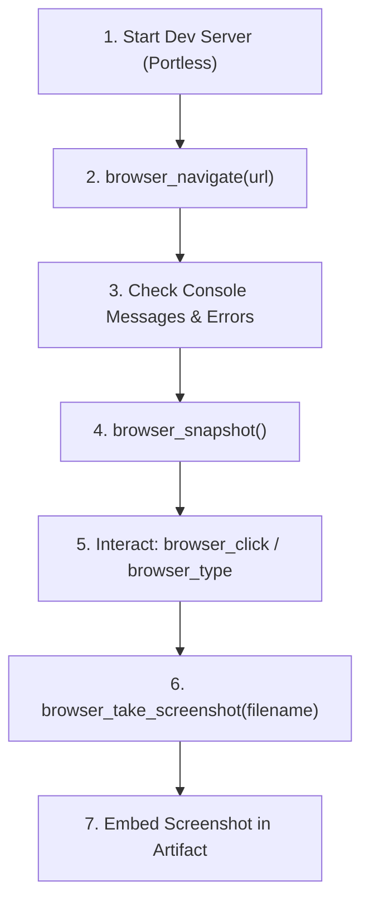

# Interactive Browser Testing & Verification (`playwright`)

This skill defines the standard procedure for agents to perform **manual beta testing**, **visual inspection**, and **runtime error debugging** using the bundled **Playwright MCP server**.

While automated end-to-end test specs (`pnpm test:e2e`) guarantee long-term regression coverage, agents need a fast, interactive loop during development to:
1. **Verify Initial Render & Hydration**: Ensure components mount cleanly without unhandled Svelte 5 rune errors or React/Vue warnings.
2. **Inspect Live Browser Console Output**: Detect runtime exceptions, failed API calls, and Convex/Clerk token errors immediately.
3. **Capture Visual Proof On Demand**: Take full-page and element screenshots and save them directly to conversation artifacts (`walkthrough.md`).
4. **Perform Interactive Exploratory Testing**: Click buttons, fill forms, toggle modals, and test keyboard accessibility using the accessibility snapshot tree.

---

## 1. Bundled MCP Server Architecture

The `overskill` plugin packages the official `@playwright/mcp` server configured for seamless local testing:

- **Headless Mode (`--headless`)**: Runs silently in the background without opening disruptive browser windows.
- **Portless SSL Bypass (`--ignore-https-errors`)**: Natively trusts self-signed local certificates on `https://*.localhost` domains.
- **Console Capture**: Automatically intercepts and attaches `console.warn`, `console.error`, and unhandled page exceptions to tool outputs.
- **Accessibility Snapshots**: Exposes semantic elements via `browser_snapshot` so agents can interact reliably without brittle CSS selectors.

### Available MCP Tools Reference

| MCP Tool | Purpose | Key Arguments |
| :--- | :--- | :--- |
| `browser_navigate` | Navigate to any URL | `url` (e.g. `https://my-app.localhost`) |
| `browser_snapshot` | Inspect semantic structure and obtain element targets | `depth`, `boxes` |
| `browser_click` | Click a button, link, or input element | `target` (from snapshot), `doubleClick`, `button` |
| `browser_type` | Type text into an input or textarea | `target`, `text` |
| `browser_take_screenshot` | Capture high-definition screenshot | `filename`, `fullPage` (boolean), `scale` ("css" \| "device") |
| `browser_wait_for` | Wait for text to appear/disappear or a time delay | `text`, `textGone`, `time` (seconds) |
| `browser_select_option`| Choose an option in a `<select>` dropdown | `target`, `values` |
| `browser_hover` | Hover over an element (e.g. dropdowns, tooltips) | `target` |
| `browser_tabs` | Manage browser tabs (list, new, close, select) | `action`, `url`, `index` |
| `browser_run_code_unsafe` | Execute arbitrary custom Playwright snippet | `code` (e.g. `async (page) => { ... }`) |

---

## 2. Standard Interactive Beta-Testing Workflow

Follow this sequence whenever verifying a newly scaffolded app, a newly implemented feature, or a reported frontend bug:



### Step 1: Ensure Local Dev Server Is Running
Verify the application is being served via Portless:
```bash
# Served over trusted local HTTPS:
https://<project-name>.localhost
```

### Step 2: Navigate to the Application
Use `browser_navigate` to open the local application:
```json
{
  "url": "https://my-app.localhost"
}
```

### Step 3: Inspect Console Messages & Page Health
Inspect the tool execution response from `browser_navigate`:
- Verify that no **unhandled JavaScript exceptions** or **runtime errors** occurred during page load.
- Common issues to watch for:
  - Svelte 5 rune reactivity misuse (e.g. mutating state outside `$state`).
  - Missing environment variables (e.g. `PUBLIC_CONVEX_URL` or `PUBLIC_CLERK_PUBLISHABLE_KEY`).
  - Convex WebSocket connection errors.
  - CSS variable reference failures (e.g. transparent Clerk modals).

### Step 4: Inspect Element Targets (`browser_snapshot`)
Call `browser_snapshot` to inspect the semantic accessibility tree. The output returns target IDs for all interactive elements:
```text
- heading "My Tasks" [level=1]
- textbox "Add a new item..." [ref=target_input]
- button "Add" [ref=target_add_btn]
```

### Step 5: Interact and Test User Flows
Perform targeted interactions using the element references from the snapshot:
```json
// Type into input field
browser_type({ "target": "target_input", "text": "Buy fresh groceries" })

// Click the submit button
browser_click({ "target": "target_add_btn" })

// Wait for the new item to render in the real-time list
browser_wait_for({ "text": "Buy fresh groceries" })
```

### Step 6: Capture Visual Proof (`browser_take_screenshot`)
Take a full-page screenshot and save it directly to the active Antigravity conversation artifact directory:

```json
browser_take_screenshot({
  "filename": "/home/bryant/.gemini/antigravity/brain/<conversation-id>/task-created.png",
  "fullPage": true
})
```

### Step 7: Embed in Conversation Artifact
Reference the captured screenshot in your `walkthrough.md` or response:
```markdown
### Visual Verification

```

---

## 3. When to Use Playwright MCP vs Automated Playwright Specs

| Capability | Playwright MCP (Interactive) | Automated Specs (`pnpm test:e2e`) |
| :--- | :--- | :--- |
| **Primary Goal** | Exploratory manual beta testing & visual proof | Regression prevention & continuous integration |
| **Execution Style** | Step-by-step tool calls driven by the agent | Batch execution running headless in CLI |
| **Output** | Live tool responses, immediate screenshots, console inspection | Pass/fail test reports, CI artifacts |
| **Ideal Timing** | During development, immediately after coding | Before git commits, pull requests, and releases |

---

## 4. Best Practices & Troubleshooting

1. **Always Use `fullPage: true` for Layout Reviews**: When capturing page overviews, set `fullPage: true` to inspect footer alignments, full list rendering, and overflow scrollbars.
2. **Check for Hidden Modals**: When testing authentication (Clerk) or dialogs (shadcn), call `browser_snapshot` after clicking triggers to confirm the modal accessibility node is active and visible.
3. **Inspect Network Errors**: If data fails to populate, check if Convex queries are returning errors in the console messages or use `browser_run_code_unsafe` to inspect network response statuses.
