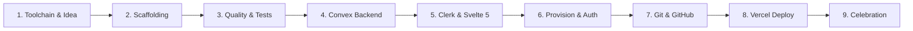

# SvelteKit Full-Stack Pipeline (Vite + Tailwind v4 + Convex + Clerk + Biome + Vitest + Playwright + Vercel)

This skill provides an automated, end-to-end orchestration runbook for scaffolding, wiring, and deploying a modern full-stack web application. It enforces strict architectural and tooling constraints for high velocity, reactivity, code quality, automated testing, and zero-defect production deployments.

## Architecture & Technology Stack

| Layer | Technology | Key Capabilities & Rules |
| :--- | :--- | :--- |
| **Toolchain & Runtime** | [`mise`](https://mise.jdx.dev) | User-space toolchain manager in `~/.local/bin`. Pins Node 22+ (`convex@1.49+` dropped Node 20), `pnpm`, `gh`, `portless`. |
| **Local Proxy & Domains** | [Portless](https://github.com/vercel-labs/portless) | **MANDATORY**: Maps `https://<project-name>.localhost` and subdomains via ephemeral ports without collisions. |
| **Framework & UI** | [SvelteKit](https://svelte.dev) + TypeScript | Modern Svelte 5 runes (`$state`, `$derived`, `$effect`, `Snippet`, `{@render}`), minimal template. |
| **Build Engine & Bundler** | [Vite](https://vite.dev) (`vite.config.ts`) | Instant HMR dev server, official `@tailwindcss/vite` compiler plugin, Vitest runner, production SSR bundling. |
| **Styling & Components** | [Tailwind CSS v4](https://tailwindcss.com) + [shadcn-svelte](https://shadcn-svelte.com) | `@tailwindcss/vite`, CSS-first design system, accessible Bits UI primitives, dark-mode ready. |
| **Package Manager** | Strict [`pnpm`](https://pnpm.io) | Deterministic & fast. **FORBIDDEN: NEVER use `npx`, `npm`, `yarn`, or `bun`. Use ONLY `pnpm dlx` or `pnpm <cmd>`.** |
| **Code Quality** | [Biome](https://biomejs.dev) (`@biomejs/biome`) | Unified Rust-powered linter & formatter. **STRICTLY NO** ESLint or Prettier. |
| **Testing** | [Vitest](https://vitest.dev) + [Playwright](https://playwright.dev) | Unit sanity & component testing via Vitest; robust E2E browser automation via Playwright. |
| **Database & Realtime** | [Convex](https://convex.dev) (`convex@1.49+`, `convex-svelte@0.15.1`) | Real-time reactive queries over WebSocket, TypeScript schema, universal SSR prefetching (`convexLoad`). Requires Node 22+. |
| **Authentication** | [Clerk](https://clerk.com) (`svelte-clerk`) | Secure auth, JWT session templates (`"aud": "convex"`), reactive runes, prebuilt UI controls. |
| **VCS & Hosting** | [GitHub CLI](https://cli.github.com) + [Vercel](https://vercel.com) | Automated repository creation (`gh repo create`) and headless zero-config deployments (`vercel --prod`). |

### Non-Negotiable Guardrails
1. **Node.js 22+ Runtime**: `convex@1.49+` dropped support for Node 20. Strictly enforce Node 22+ across `.mise.toml`, `package.json` (`"engines": { "node": ">=22" }`), and Vercel build settings.
2. **Strict Package Toolchain**: NEVER invoke `npx`, `npm`, `yarn`, or `bun`. Use ONLY `pnpm dlx <pkg>` for CLI tools and `pnpm <cmd>` for project packages.
3. **Mandatory Portless Routing**: Local dev servers MUST be served under `https://<project-name>.localhost` (and `https://<endpoint>.<project-name>.localhost` for subdomains) via Portless. Never expose raw localhost ports.
4. **Svelte 5 Runes Only**: Never use deprecated Svelte 4 syntax (`export let`, `$:`, `<slot />`). Use `$state`, `$derived`, `$effect`, and `{@render}` snippets.
5. **Clerk Context Boundary**: NEVER call `useClerkContext()` inside the `<script>` of root `+layout.svelte`. Delegate client auth bridging to descendant component `src/lib/components/ConvexAuth.svelte` using `setupAuth()`, awaiting `clerkReady` for `initialState`.
6. **Direct Query Property Access**: In `convex-svelte@0.15.1`, queries are reactive rune objects, NOT stores. NEVER use `$tasks.*` or `$query.*` store syntax. Access properties directly: `tasks.isLoading`, `tasks.data`, `tasks.error`.
7. **Non-SWE Plain-English Protocol**: Never surface raw stack traces or TypeScript error codes. Interview the user on their app idea, guide key setups click-by-click, and celebrate milestones with clickable links.

---

## Companion Resources Index

Verbose boilerplate files and deep-dive technical guides are modularized into `templates/` and `references/`.

### Templates (24 Files)

| Template File | Target Destination | Purpose |
| :--- | :--- | :--- |
| [`templates/.mise.toml`](templates/.mise.toml) | `.mise.toml` | Toolchain pinning (Node 22, pnpm, gh, portless) |
| [`templates/svelte.config.js`](templates/svelte.config.js) | `svelte.config.js` | Adapter-auto, vitePreprocess, and `$convex` path alias |
| [`templates/vite.config.ts`](templates/vite.config.ts) | `vite.config.ts` | Vite build config with `@tailwindcss/vite` & Vitest |
| [`templates/app.d.ts`](templates/app.d.ts) | `src/app.d.ts` | Ambient TypeScript declarations and Clerk locals |
| [`templates/app.css`](templates/app.css) | `src/app.css` | Tailwind v4 theme & `hsl(...)` color wrappers for shadcn/Clerk |
| [`templates/components.json`](templates/components.json) | `components.json` | shadcn-svelte CLI registry & path configuration |
| [`templates/biome.json`](templates/biome.json) | `biome.json` | Unified Biome v1.9.4 linter & formatter configuration |
| [`templates/convex-schema.ts`](templates/convex-schema.ts) | `convex/schema.ts` | Convex database schema with table definitions & indexes |
| [`templates/convex-tasks.ts`](templates/convex-tasks.ts) | `convex/tasks.ts` | Authenticated queries and mutations with `ctx.auth` |
| [`templates/convex-auth.config.ts`](templates/convex-auth.config.ts) | `convex/auth.config.ts` | Convex auth provider config matching Clerk with audience `"convex"` |
| [`templates/hooks.ts`](templates/hooks.ts) | `src/hooks.ts` | Universal client/server hooks (`transport` & `initConvex`) |
| [`templates/hooks.server.ts`](templates/hooks.server.ts) | `src/hooks.server.ts` | Server hooks sequence with Clerk & `withServerConvexToken` |
| [`templates/layout.server.ts`](templates/layout.server.ts) | `src/routes/+layout.server.ts` | Root server loader returning `isAuthenticated` & `buildClerkProps` |
| [`templates/ConvexAuth.svelte`](templates/ConvexAuth.svelte) | `src/lib/components/ConvexAuth.svelte` | Descendant auth bridge using `setupAuth()`, `clerkReady`, `initialState` |
| [`templates/layout.svelte`](templates/layout.svelte) | `src/routes/+layout.svelte` | Root layout with `setupConvex()`, `<ClerkProvider>`, `<ConvexAuth>` |
| [`templates/page.ts`](templates/page.ts) | `src/routes/+page.ts` | Universal route loader prefetching query via `convexLoad` |
| [`templates/page.svelte`](templates/page.svelte) | `src/routes/+page.svelte` | Reactive UI consuming queries via direct rune property access |
| [`templates/unit.test.ts`](templates/unit.test.ts) | `src/demo.test.ts` | Baseline Vitest unit sanity test |
| [`templates/demo.spec.ts`](templates/demo.spec.ts) | `e2e/demo.test.ts` | Playwright E2E smoke test verifying page and auth elements |
| [`templates/playwright.config.ts`](templates/playwright.config.ts) | `playwright.config.ts` | Playwright test config with `reuseExistingServer: true` |
| [`templates/env.example`](templates/env.example) | `.env.example` | Environment variable reference template for Convex & Clerk |
| [`templates/LICENSE.mit`](templates/LICENSE.mit) | `LICENSE` | Standard MIT open-source license template |
| [`templates/create-test-user.ts`](templates/create-test-user.ts) | `scripts/create-test-user.ts` | Clerk Backend API script provisioning test users with auth tickets |
| [`templates/record-demo.ts`](templates/record-demo.ts) | `scripts/record-demo.ts` | Automated Playwright walkthrough recorder & animated GIF generator |

### References (11 Files)

| Reference File | Focus | When to Read |
| :--- | :--- | :--- |
| [`references/mise.md`](references/mise.md) | Polyglot runtime management | Missing developer tools, PATH setup, or `prefer_offline = true` |
| [`references/portless.md`](references/portless.md) | Local proxy & domain routing | Portless setup, custom subdomains, Cloudflare Tunnels, Tailscale |
| [`references/sveltekit.md`](references/sveltekit.md) | SvelteKit SSR & architecture | Server hooks sequencing, `$convex` alias, load function contracts |
| [`references/convex.md`](references/convex.md) | Convex database & `convex-svelte` | `convex-svelte@0.15.1`, `convexLoad`, SSR prefetching, Node 22+ |
| [`references/clerk.md`](references/clerk.md) | Clerk authentication & JWT templates | Context boundaries, `"aud": "convex"` claim, Backend API tokens |
| [`references/tailwind-and-shadcn.md`](references/tailwind-and-shadcn.md) | Tailwind v4 & shadcn-svelte | `@tailwindcss/vite`, CSS design system, `hsl(...)` color wrappers |
| [`references/biome.md`](references/biome.md) | Biome linting & formatting | Replacing ESLint/Prettier, Biome v1.9.4 rules, package scripts |
| [`references/testing.md`](references/testing.md) | Vitest & Playwright testing | Unit/E2E test setup, dev server reuse, avoiding test hangs |
| [`references/playwright-walkthroughs.md`](references/playwright-walkthroughs.md) | Visual proof & demo recording | Playwright CLI probing, session saving, high-definition GIF recording |
| [`references/vercel.md`](references/vercel.md) | Headless Vercel deployment | Vercel CLI deployment, Node 22.x engine setting, env synchronization |
| [`references/non-swe-guide.md`](references/non-swe-guide.md) | Plain-English user communication | Idea interview, zero-jargon communication, milestone celebrations |

> [!NOTE]
> **Standalone Raw-URL Fallback**: If consuming `SKILL.md` directly via raw URL without cloning the repository, fetch sibling files from:
> `https://raw.githubusercontent.com/brychanrobot/overskill/main/skills/sveltekit-convex-clerk/<templates|references>/<filename>`

---

## Live Documentation Freshness Protocol

Consult upstream machine-readable documentation endpoints before implementing novel features:

| Framework / Service | Live Upstream Endpoint | Purpose |
| :--- | :--- | :--- |
| **Svelte 5 Runes** | `https://svelte.dev/docs/svelte/llms.txt` | Core reactivity, runes (`$state`, `$derived`, `$effect`), snippets |
| **SvelteKit** | `https://svelte.dev/docs/kit/llms.txt` | Loaders, server hooks, routing, form actions |
| **Svelte CLI (`sv`)** | `https://svelte.dev/docs/cli/llms.txt` | Scaffolding flags, official add-ons |
| **Tailwind CSS v4** | `https://tailwindcss.com/docs` | CSS-first configuration, theme variables |
| **shadcn-svelte** | `https://shadcn-svelte.com/docs` | Bits UI component primitives, CLI add commands |
| **Convex Realtime** | `https://docs.convex.dev/llms.txt` *(append `.md` to doc URLs)* | Schema definitions, reactive queries, mutations, `convex-svelte` |
| **Clerk Auth** | `https://clerk.com/SKILL.md` | Single-file agent runbook for Clerk SDKs & JWT templates |
| **Vercel** | `https://vercel.com/docs/llms.txt` | CLI deployment, project settings, environment variables |
| **Biome** | `https://biomejs.dev/` | Linter rules, formatter options, CI commands |
| **Mise** | `https://mise.jdx.dev` | User-space toolchain management |

---

## Execution Runbook (Steps 1–9)



### Step 1: System Prerequisites & Idea Discovery
1. Check toolchain presence and verify Node 22+ (`convex@1.49+` dropped Node 20):
   ```bash
   command -v node && node -v # Node 22+ required (convex@1.49+ dropped Node 20)
   command -v pnpm && command -v gh && command -v portless && portless doctor
   ```
2. Verify CLI authentication states (**FORBIDDEN: NEVER use `npx`**):
   ```bash
   gh auth status && pnpm dlx vercel whoami && pnpm dlx convex whoami && pnpm dlx clerk whoami
   ```
   If any CLI reports unauthenticated, execute the required login recovery command (**NEVER use `npx`**):
   ```bash
   gh auth login
   pnpm dlx vercel login
   pnpm dlx convex login
   pnpm dlx clerk auth login
   ```
3. Pin project tools with [`templates/.mise.toml`](templates/.mise.toml). If tools are missing, offer automated setup via [`references/mise.md`](references/mise.md).
4. Conduct the Idea Interview per [`references/non-swe-guide.md`](references/non-swe-guide.md): ask what the user wants to build and customize the schema/UI accordingly.

### Step 2: Scaffolding Automation (SvelteKit + Tailwind v4 + Testing)
1. Scaffold minimal TypeScript SvelteKit project and official add-ons:
   ```bash
   pnpm dlx sv create . --template minimal --types ts --no-add-ons
   pnpm dlx sv add tailwindcss vitest="usages:unit,component" playwright --install pnpm
   pnpm exec playwright install --with-deps chromium
   ```
2. Configure path aliases, build settings, test configuration, and styling:
   - [`templates/svelte.config.js`](templates/svelte.config.js) $\to$ `svelte.config.js` (ensuring `$convex: 'convex'` alias)
   - [`templates/vite.config.ts`](templates/vite.config.ts) $\to$ `vite.config.ts`
   - [`templates/playwright.config.ts`](templates/playwright.config.ts) $\to$ `playwright.config.ts`
   - [`templates/app.d.ts`](templates/app.d.ts) $\to$ `src/app.d.ts`
   - [`templates/app.css`](templates/app.css) $\to$ `src/app.css`
   See [`references/sveltekit.md`](references/sveltekit.md) and [`references/tailwind-and-shadcn.md`](references/tailwind-and-shadcn.md).

### Step 3: Tooling, Testing & UI Components Setup
1. Install Biome and shadcn-svelte:
   ```bash
   pnpm add -D @biomejs/biome@^1.9.4
   pnpm dlx shadcn-svelte@latest init -y
   pnpm dlx shadcn-svelte@latest add button card input label badge separator scroll-area tooltip alert dropdown-menu avatar
   ```
2. Copy configuration and test baselines ([`templates/biome.json`](templates/biome.json) $\to$ `biome.json`, [`templates/components.json`](templates/components.json) $\to$ `components.json`, [`templates/unit.test.ts`](templates/unit.test.ts) $\to$ `src/demo.test.ts`, [`templates/demo.spec.ts`](templates/demo.spec.ts) $\to$ `e2e/demo.test.ts`):
   ```bash
   cp templates/biome.json biome.json
   cp templates/components.json components.json
   cp templates/unit.test.ts src/demo.test.ts
   cp templates/demo.spec.ts e2e/demo.test.ts
   ```
3. Add Node 22+ engine constraint and unified scripts to `package.json`:
   ```json
   "engines": {
     "node": ">=22"
   },
   "scripts": {
     "dev": "portless run vite dev",
     "build": "vite build",
     "preview": "portless preview.<project-name> vite preview",
     "check": "svelte-kit sync && svelte-check --tsconfig ./tsconfig.json && biome check .",
     "lint": "biome lint .",
     "format": "biome format --write .",
     "lint:fix": "biome check --write .",
     "test": "pnpm run test:unit && pnpm run test:e2e",
     "test:unit": "vitest run",
     "test:e2e": "playwright test"
   }
   ```
   See [`references/biome.md`](references/biome.md) and [`references/testing.md`](references/testing.md).

### Step 4: Backend & Database Wiring (Convex)
1. Install Convex and reactive Svelte client:
   ```bash
   pnpm add convex convex-svelte@0.15.1
   ```
2. Copy [`templates/convex-schema.ts`](templates/convex-schema.ts) to `convex/schema.ts`, [`templates/convex-tasks.ts`](templates/convex-tasks.ts) to `convex/tasks.ts`, and [`templates/convex-auth.config.ts`](templates/convex-auth.config.ts) to `convex/auth.config.ts`. Tailor schema tables to the user's domain model. See [`references/convex.md`](references/convex.md).

### Step 5: Reactive UI & Auth Wiring (Clerk + Svelte 5)
1. Install Clerk Svelte SDK:
   ```bash
   pnpm add svelte-clerk
   ```
2. Wire the universal SSR and auth bridge pipeline:
   - Universal SSR transport: copy [`templates/hooks.ts`](templates/hooks.ts) to `src/hooks.ts`.
   - Server hooks: copy [`templates/hooks.server.ts`](templates/hooks.server.ts) to `src/hooks.server.ts` (`withServerConvexToken`).
   - Server root loader: copy [`templates/layout.server.ts`](templates/layout.server.ts) to `src/routes/+layout.server.ts` (`isAuthenticated`).
   - Child auth synchronizer: copy [`templates/ConvexAuth.svelte`](templates/ConvexAuth.svelte) to `src/lib/components/ConvexAuth.svelte` (`setupAuth()`).
   - Root layout: copy [`templates/layout.svelte`](templates/layout.svelte) to `src/routes/+layout.svelte` (`setupConvex()`).
   - Universal page loader: copy [`templates/page.ts`](templates/page.ts) to `src/routes/+page.ts` (`convexLoad()`).
   - Reactive page UI: copy [`templates/page.svelte`](templates/page.svelte) to `src/routes/+page.svelte` (direct rune property access `tasks.isLoading`).
   - Environment template: copy [`templates/env.example`](templates/env.example) to `.env.example`.
   See [`references/clerk.md`](references/clerk.md), [`references/convex.md`](references/convex.md), and [`references/sveltekit.md`](references/sveltekit.md).

### Step 6: Backend Provisioning & Click-by-Click Auth Setup
1. Provision Convex development backend headlessly:
   ```bash
   pnpm convex dev --once
   ```
2. Configure Clerk via CLI (**Option A**) or Dashboard (**Option B** per [`references/clerk.md`](references/clerk.md)):
   ```bash
   pnpm dlx clerk auth login
   pnpm dlx clerk apps list --json
   pnpm dlx clerk api jwt_templates create --name convex --claims '{"aud": "convex", "email": "{{user.primary_email_address}}", "name": "{{user.full_name}}", "picture": "{{user.image_url}}"}'
   pnpm dlx clerk doctor
   pnpm convex env set CLERK_FRONTEND_API_URL <user-fapi-url>
   ```
3. Verify code quality and run tests:
   ```bash
   pnpm run lint && pnpm run format && pnpm run test:unit
   ```
4. Prune stale routes and start Portless dev server as a persistent background daemon (`IsDaemon: true`), copy walkthrough scripts, then probe and test interactively:
   ```bash
   portless prune
   pnpm run dev # launch as persistent background daemon (IsDaemon: true)
   mkdir -p scripts && cp templates/create-test-user.ts scripts/create-test-user.ts && cp templates/record-demo.ts scripts/record-demo.ts
   node skills/playwright/scripts/playwright-cli.ts probe https://<project-name>.localhost
   node skills/playwright/scripts/playwright-cli.ts auth-setup --save-session
   node skills/playwright/scripts/playwright-cli.ts screenshot https://<project-name>.localhost --auth playwright/.clerk/user.json -o preview.png
   ```
   Record walkthrough media using [`templates/create-test-user.ts`](templates/create-test-user.ts) and [`templates/record-demo.ts`](templates/record-demo.ts) in `scripts/`. See [`references/playwright-walkthroughs.md`](references/playwright-walkthroughs.md) and [`references/portless.md`](references/portless.md).

### Step 7: Remote GitHub Repository Creation & Licensing
1. Apply MIT license if public using [`templates/LICENSE.mit`](templates/LICENSE.mit):
   ```bash
   YEAR=$(date +%Y) AUTHOR=$(gh api user -q '.name // .login' 2>/dev/null || git config user.name || echo "Author")
   sed -e "s/<YEAR>/$YEAR/g" -e "s/<AUTHOR>/$AUTHOR/g" templates/LICENSE.mit > LICENSE
   ```
2. Initialize repository and push to GitHub:
   ```bash
   git init -b main && git add -A && git commit -m "feat: initial scaffold with sveltekit, convex, clerk, and biome"
   gh repo create <repo-name> --public --source=. --push # or --private
   gh repo view
   ```

### Step 8: Headless Vercel Deployment & Environment Sync
1. Run pre-deployment verification gate:
   ```bash
   pnpm run check && pnpm run test:unit && pnpm run test:e2e
   ```
2. Deploy Convex production backend:
   ```bash
   pnpm convex deploy
   ```
3. Deploy headlessly to Vercel and sync environment variables:
   ```bash
   pnpm add -D vercel && pnpm vercel --prod --yes
   pnpm vercel env add PUBLIC_CONVEX_URL production
   pnpm vercel env add PUBLIC_CLERK_PUBLISHABLE_KEY production
   pnpm vercel env add CLERK_SECRET_KEY production
   pnpm vercel --prod --yes
   ```
   *Note*: Ensure Vercel Node.js version is set to **`22.x`** in Project Settings. See [`references/vercel.md`](references/vercel.md).

### Step 9: Celebration & Shareable Links Handoff
Present results to the user with enthusiasm and clear links per [`references/non-swe-guide.md`](references/non-swe-guide.md):
- **Local Preview**: `https://<project-name>.localhost` (served via Portless over trusted local HTTPS).
- **Live Production App**: `https://<your-project>.vercel.app` (shareable web/mobile link).
- **Remote Dev Link** *(optional)*: `https://<project-name>.<your-domain.com>` via Cloudflare Tunnel or Tailscale.
- Suggest 2–3 creative next steps (e.g., search/filter, image uploads, dark mode styling).

---

## Troubleshooting & Common Pitfalls

| Issue / Error | Root Cause | Resolution & Guide |
| :--- | :--- | :--- |
| `convex@1.49+ wanted node ">=22"` | Node 20 dropped upstream | Set `node = "22"` in `.mise.toml`, `package.json`, and Vercel ([`references/convex.md`](references/convex.md)) |
| `useClerkContext()` boundary error | Called in root `+layout.svelte` script | Call inside child component [`templates/ConvexAuth.svelte`](templates/ConvexAuth.svelte) ([`references/clerk.md`](references/clerk.md)) |
| `$tasks.isLoading` / `$query.data` error | Store syntax used on rune objects | Access properties directly without `$`: `tasks.isLoading`, `tasks.data` ([`references/convex.md`](references/convex.md)) |
| `client.setAuth()` conflicts | Manual coordination bypasses `setupAuth` | Delegate auth bridging to [`templates/ConvexAuth.svelte`](templates/ConvexAuth.svelte) with `setupAuth()` ([`references/convex.md`](references/convex.md)) |
| Missing `$convex` alias | Cannot resolve `$convex/_generated/api` | Configure `alias: { $convex: 'convex' }` in [`templates/svelte.config.js`](templates/svelte.config.js) ([`references/sveltekit.md`](references/sveltekit.md)) |
| Convex query `Unauthenticated` | Clerk JWT missing audience claim | Set `"aud": "convex"` in Clerk JWT template matching `convex/auth.config.ts` ([`references/clerk.md`](references/clerk.md)) |
| SSR flash / missing hydration | Unauthenticated SSR or missing sequence | Sequence `withClerkHandler`, `convexAuth`, `convexLoadHydration` in `hooks.server.ts` ([`references/sveltekit.md`](references/sveltekit.md)) |

---

## Completion Verification Checklist

- [ ] Node 22+ requirement strictly verified (`node -v` $\ge$ 22.0.0; `node = "22"` in `.mise.toml`, `"engines": { "node": ">=22" }` in `package.json`, Node 22.x on Vercel; `convex@1.49+` dropped Node 20).
- [ ] `pnpm --version` confirmed `pnpm` is strictly used (no `npm` or `yarn` lockfiles created).
- [ ] SvelteKit initialized with `$convex` alias configured in `svelte.config.js`.
- [ ] Universal SSR `transport` configured alongside `initConvex(PUBLIC_CONVEX_URL)` in `src/hooks.ts`.
- [ ] Server hooks pipeline sequenced with `sequence(withClerkHandler(), convexAuth, convexLoadHydration)` using `withServerConvexToken` in `src/hooks.server.ts`.
- [ ] Root layout server loader returns `isAuthenticated: Boolean(auth.userId)` alongside `buildClerkProps(auth)` in `src/routes/+layout.server.ts`.
- [ ] `ConvexAuth.svelte` nested inside `<ClerkProvider>`, synchronizing auth via `setupAuth()`, awaiting `clerkReady` for `initialState`, and calling `invalidateAll()` on auth state transitions.
- [ ] Root layout `src/routes/+layout.svelte` initializes Convex via `setupConvex(PUBLIC_CONVEX_URL)` and wraps `<ClerkProvider>` around `<ConvexAuth>`.
- [ ] Universal route loader `src/routes/+page.ts` pre-populates query data using `convexLoad(api.tasks.list, isAuthenticated ? {} : 'skip', { fetch })`.
- [ ] Page component `src/routes/+page.svelte` consumes `useAuth()` and derived preloaded query `const tasks = $derived(data.tasks)` using direct property access (`tasks.isLoading`, `tasks.error`, `tasks.data` without `$`).
- [ ] Zero `$tasks.*` or `$query.*` Svelte store syntax used anywhere in components.
- [ ] Tailwind CSS v4 configured with `@tailwindcss/vite`; `shadcn-svelte` components and `src/app.css` configured with `hsl(...)` color wrappers.
- [ ] No `eslint` or `prettier` packages or configuration files exist in the project root.
- [ ] `biome.json` is configured and `pnpm run check` passes without warnings or formatting errors.
- [ ] Portless configured in `package.json` with `https://<project-name>.localhost` and trusted CA certificate (`portless doctor`).
- [ ] Vitest unit tests and Playwright E2E tests are configured and pass (`pnpm run test`).
- [ ] Visual proof captured (screenshots and demo GIF via Playwright + ffmpeg) and embedded in walkthrough artifact.
- [ ] `convex/auth.config.ts` matches Clerk's Frontend API URL with audience `'convex'`.
- [ ] Remote GitHub repository created via `gh repo create` (with MIT license if public).
- [ ] Project successfully deployed to Vercel with Node 22.x runtime and production environment variables verified.
- [ ] Live shareable Vercel URL and local preview URL (`https://<project-name>.localhost`) presented clearly to the user.
